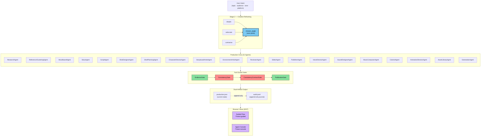

# Architecture — Open Production

This document is the architecture writeup referenced in the README. It describes the current implementation as of the IBM Challenge submission.

## What's shipped

| Layer | Status | Location |
|---|---|---|
| Production Document schema (JSON + Python dataclass) | Built | `src/schema/production_document.py`, `docs/schema/production-document.schema.json` |
| ProductionService (init / load / save / snapshot / branch / apply_event) | Built | `src/service/production_service.py` |
| State machine (6 states, forward-only transitions, revision loop) | Built | `src/service/production_service.py:_ALLOWED_TRANSITIONS` |
| Immutable event log (append-only JSONL + dual-artifact) | Built | `src/audit/recorder.py`, `src/service/production_service.py` |
| Version snapshots + branching | Built | `ProductionService.snapshot()`, `ProductionService.create_branch()` |
| BaseAgent scope contract + ScopeViolation enforcement | Built | `src/agents/base.py` |
| CreativeReframing agent (3 creative angles, `get_default_client()` wired) | Built — Bob session 2 | `src/agents/creative_reframing.py` |
| ConfirmGate (TtyConfirmSink + AutoConfirmSink) | Built — Bob session 5 | `src/agents/confirm_gate.py` |
| ResearchAgent (Stage 2, source gate, gap detection) | Built | `src/agents/research_agent.py` |
| ReferenceClusteringAgent (Stage 3, reference clustering) | Built | `src/agents/reference_clustering.py` |
| MoodboardAgent (Stage 4, MoodSpec generation) | Built | `src/agents/moodboard.py` |
| StoryAgent (Stage 6, narrative structures, structure_locked gate) | Built | `src/agents/story.py` |
| ScriptAgent (Stage 7, genre-keyed scene templates, script_locked gate) | Built | `src/agents/script.py` |
| ShotDesignerAgent (3 camera+lighting proposals per shot) | Built | `src/agents/shot_designer.py` |
| ShotPlanningAgent (Stage 10, ordered shot lists from scene/script) | Built | `src/agents/shot_planner.py` |
| CharacterDirectorAgent (create + review + commit ops, Stage 8 write-back) | Built | `src/agents/character_director.py` |
| StoryboardArtistAgent (ASCII blocking diagrams) | Built | `src/agents/storyboard_artist.py` |
| EnvironmentArtistAgent (3 environment specs, consistency review) | Built | `src/agents/environment_artist.py` |
| ReviewerAgent (5 check types: consistency, brief, quality, continuity, stage_gate) | Built | `src/agents/reviewer.py` |
| EditorAgent (3 cut assembly proposals) | Built | `src/agents/editor.py` |
| PublisherAgent (publish manifest proposals, readiness gate) | Built | `src/agents/publisher.py` |
| VoiceDirectorAgent (K.5, per-line emotion/pace/emphasis/subtext) | Built — Bob session 8 | `src/agents/voice_director.py` |
| SoundDesignerAgent (K.6, location × mood ambient/sfx/silence palette) | Built — Bob session 8 | `src/agents/sound_designer.py` |
| MusicComposerAgent (K.7, narrative-function-keyed music cue briefs) | Built — Bob session 8 | `src/agents/music_composer.py` |
| ColoristAgent (K.9, 3 color grade proposals per emotional intent) | Built — Bob session 8 | `src/agents/colorist.py` |
| AnimationDirectorAgent (Stage 18, motion proposals, motion_locked gate) | Built | `src/agents/animation_director.py` |
| AssetLibraryAgent (Stage 15, asset inventory + gap detection) | Built | `src/agents/asset_library.py` |
| GenerationAgent (Stage 16, GenerationPlugin protocol, MockGenerationPlugin) | Built | `src/agents/generation.py` |
| Gate-validation suite (EvidenceGate, ConsistencyGate, PublicationGate, ConsistencyContractGate) | Built — Bob session 3 | `src/validation/gates.py` |
| Transform catalog (6 transforms + VisualQualityGate) | Built — Bob session 6 | `src/transforms/` |
| Video vertical sketch | Built — Bob session 7 | `src/videos/` |
| Browser demo: Guided Production Flow + Agent Console | Built | `src/public_demo/server.py` |
| Consistency Contract violation fixture (live demo artifact) | Built | `output/consistency_violation/` |
| Crew demo script (all agents in sequence) | Built | `examples/run_crew_demo.py` |
| Wireframes (SVG + PNG) for all 5 views | Designed | `docs/wireframes/` |

Open Production is a production-crew model built on a medium-blind kernel. The architecture is designed to generalize from the research-writing vertical to video and beyond.

---

## System diagram

The diagram below is the canonical architecture. It lives at `architecture-diagram.mmd` (Mermaid source) and renders natively in GitHub Markdown, Obsidian, and VS Code.



**Reading the diagram:**

- **Intent → Reframing.** User declares a topic; three creative angles are proposed (skeptic / advocate / contrarian); user picks one. This is the AI-as-creative-partner differentiator.
- **Production Crew (21 agents).** Every agent declares a `WRITABLE_FIELDS` scope contract. No agent calls another — all share the `Production` state document via `ProductionService`.
- **Fail-closed gates.** Four gates run in sequence. Any gate can block advancement. All decisions are logged as `AuditEntry` records.
- **Dual-artifact output.** Every run writes `production.json` (current state snapshot) and `audit.jsonl` (append-only event journal). Together they form a reproducible audit trail.
- **Browser views.** Two MVP views: Guided Production Flow (`/?view=guided`) and Agent Console (`/?view=console`). Both read from the same `ProductionService` state.

---

## Production Crew Model

Open Production implements a **production crew** where every AI action is a proposal and every proposal requires human approval before it modifies state.

```
Reconciliation loop per agent tick:
  acquire  → read current Production from ProductionService
  detect   → identify what the agent can contribute
  plan     → generate proposals (always 3 options)
  dispatch → return proposals to the caller
  commit   → ProductionService.apply_event() — only after human approval
  release  → updated Production is persisted; next agent reads new state
```

### Agent Scope Contracts

Every agent declares `WRITABLE_FIELDS: frozenset[str]`. `BaseAgent._enforce_scope()` raises `ScopeViolation` if the agent's output contains a field outside this set. Agents do not call each other — they read from and write to the shared `Production` state.

| Agent | Can Write | Status |
|---|---|---|
| `CreativeReframing` | — (read-only proposer) | ✅ Implemented |
| `ConfirmGate` | — (gate, no state write) | ✅ Implemented |
| `ResearchAgent` | — (proposer, gate check) | ✅ Implemented |
| `ReferenceClusteringAgent` | — (proposer) | ✅ Implemented |
| `MoodboardAgent` | — (proposer) | ✅ Implemented |
| `StoryAgent` | — (proposer, structure_locked gate) | ✅ Implemented |
| `ScriptAgent` | — (proposer, script_locked gate) | ✅ Implemented |
| `ShotDesignerAgent` | `Shot.camera`, `Shot.lighting` | ✅ Implemented |
| `ShotPlanningAgent` | `Scene.shots` | ✅ Implemented |
| `CharacterDirectorAgent` | `Production.characters` | ✅ Implemented |
| `StoryboardArtistAgent` | `Shot.storyboard_frame` | ✅ Implemented |
| `EnvironmentArtistAgent` | `Production.environments` | ✅ Implemented |
| `ReviewerAgent` | — (evaluator, no state write) | ✅ Implemented |
| `EditorAgent` | `Timeline.scene_order`, `Shot.duration_sec` | ✅ Implemented |
| `PublisherAgent` | `Production.metadata` | ✅ Implemented |
| `VoiceDirectorAgent` | `Shot.audio.voice_direction` | ✅ Implemented |
| `SoundDesignerAgent` | `Shot.audio.sfx`, `Scene.sound_palette` | ✅ Implemented |
| `MusicComposerAgent` | `Scene.music_cue`, `Timeline.music_cues` | ✅ Implemented |
| `ColoristAgent` | `Shot.color_spec`, `Scene.color_look` | ✅ Implemented |
| `AnimationDirectorAgent` | `Shot.motion_spec`, `Timeline.transitions` | ✅ Implemented |
| `AssetLibraryAgent` | — (inventory reader, no state write) | ✅ Implemented |
| `GenerationAgent` | `Shot.generation`, `Shot.status`, `Shot.version_history` | ✅ Implemented |

---

## Production Document

The `Production` dataclass is the root state object. All views and all agents read from and write to the same document.

```python
Production {
  id: "prod_<hex>"              # Globally unique
  state: ProductionState        # DRAFT → BRIEFED → IN_PRODUCTION → IN_REVIEW → APPROVED → PUBLISHED
  intent: IntentDocument        # topic, audience, tone, platform
  scenes: list[Scene]           # Scene → Shot → CameraSpec, LightingSpec, AudioSpec, GenerationResult
  characters: list[Character]   # Character → ConsistencyContract → visual_anchors
  environments: list[Environment]
  style_tokens: list[StyleToken]
  brand_kit: BrandKit | None
  timeline: Timeline | None     # scene_order, transitions, music_cues
  branches: list[Branch]        # named forks of the production
  snapshots: list[VersionSnapshot]  # content-addressed point-in-time saves
  audit_trail: list[AuditEntry] # append-only event log (Git for productions)
}
```

### State Machine

```
DRAFT → BRIEFED → IN_PRODUCTION → IN_REVIEW → APPROVED → PUBLISHED
                                      ↑               ↓
                                   IN_PRODUCTION ←─ (revision loop)
```

All transitions are forward-only except the `IN_REVIEW → IN_PRODUCTION` revision loop. Transitions require a `state_transition` `AuditEntry`. The `_ALLOWED_TRANSITIONS` table in `production_service.py` enforces this programmatically — illegal transitions raise `StorageError`.

### Immutable Event Log

Every action on a Production is an `AuditEntry` appended to an append-only log:

```python
AuditEntry {
  id: "evt_<hex>"
  ts: ISO8601
  actor: "human" | agent_id | "system"
  action_type: gate_decision | decision | state_transition | snapshot | branch | ...
  payload: dict
  state_before: content_hash[:16] | None
  state_after: content_hash[:16] | None
}
```

The production state at any point in time can be reconstructed from the event log. `ProductionService` writes two artifacts per run: a `production.json` (latest state) and an `audit.jsonl` (append-only journal).

---

## The five primitives

Open Production is built on five primitives that survive every creative medium:

- **Source** — an artifact's identity. Content-addressed. SHA-256. Immutable.
- **Transform** — an atomic operation. Render, transcribe, summarize. Typed. Idempotent.
- **Composition** — a DAG of transforms. A workflow, a pipeline, a recipe.
- **Evaluation** — a judgment. Quality, faithfulness, novelty. Gates live here.
- **Intent** — a desired state. What should exist after the kernel acts.

The kernel is **medium-blind** — it has no concept of research, video, or audio. It only knows these five. Every domain becomes an application layer over the primitives.

---

## Fail-closed as a first-class principle

Four gates in Open Production fail closed:

- **Evidence gate** — every claim must cite a source. Rejection is logged.
- **Consistency gate** — contradictions between sources are surfaced, not silently overwritten.
- **ConsistencyContract gate** — required attributes must be present and prohibited attributes absent in every generation. Stop-fast on first violation.
- **Publication gate** — refuses to publish with incomplete metadata (no DOI, no author attribution, missing publication date).

The system does not paper over failure. It surfaces failure. This is **"AI as creative partner that admits when it cannot meet the bar."**

---

## MVP UI Views

Two browser views are implemented for the MVP. The remaining three are intentionally deferred to future releases (wireframes exist at `docs/wireframes/`).

| View | Status | Route |
|---|---|---|
| **Guided Production Flow** | ✅ Implemented | `/?view=guided` |
| **Agent Console** | ✅ Implemented | `/?view=console` |
| Director's Canvas | 🗺 Roadmap | — |
| Timeline Editor | 🗺 Roadmap | — |
| Node Graph | 🗺 Roadmap | — |

Both MVP views share state via `ProductionService`. The Guided Flow creates a production; the Agent Console reads and auto-refreshes the same production's audit log at 5-second intervals.

---

## The creative-reframing differentiator

Before writing, the creative-reframing agent proposes three angles on the topic:

- **Skeptic** — what could go wrong, what's overstated, what's missing.
- **Advocate** — why this matters, the strongest case, who benefits.
- **Contrarian** — the non-obvious take, the contrarian-but-defensible position.

The user picks one. The chosen angle becomes the document's frame. This is the move that takes Open Production from "AI that writes content" to **"AI as creative partner."**

### Implementation contract

- Input: `{ topic, audience, tone, context? }`
- Output: `{ angles: [skeptic, advocate, contrarian] }` — always exactly three.
- Validation: malformed JSON triggers one retry; second failure falls back to deterministic angles.
- Tests: 5 unit tests covering happy path, malformed JSON retry, missing-context safety, fallback, and angle-distinctness.

---

## Test suite

```
324 tests passing, 0 failures, 0 errors  (python -m pytest tests/ -q)
```

Coverage spans: all 21 agents, gates (4), production service (8), demo flow, view switching, transforms (11), videos (9), reviewer, publisher, environment artist, consistency violation fixture, voice director, sound designer, music composer, colorist, animation director (18), asset library, generation agent, story agent, script agent, shot planner.

---

## Why this matters for the IBM challenge rubric

| Criterion | How Open Production scores |
|---|---|
| **Technical Execution** | Production Document schema · 21-agent crew · typed scope contracts · state machine · event log · fail-closed gates · snapshot + branching · 324 tests |
| **Innovation** | Creative reframing as a first-class primitive · AI-as-creative-partner framing · medium-blind kernel · production crew model with formal scope contracts · `GenerationPlugin` protocol for swap-in Runway/Veo backends |
| **Challenge Fit** | "Reimagine Creative Industries with AI" — the production crew model directly reimagines how creative work is planned, reviewed, and approved |
| **Feasibility** | Browser demo runs end-to-end; 21 agents are live; all gates are operational; audit trail is a real artifact; `get_default_client()` wired to live LLM when `OPENAI_API_KEY` is set |
| **Real-World Impact** | Targets creators who need transparent, auditable AI collaboration — not silent automation |

---

## Inspired by

- **OpenMontage** (`https://github.com/calesthio/OpenMontage.git`) — for the live studio + Replay Run pattern.
- **Kubernetes reconciliation loops** — for the declarative desired-state model. The kernel is a controller, not a runner.
- **Git's content-addressed store** — for immutable, content-addressed artifacts.
- **Cursor's agent panel** — for the proposal-approve-adjust interaction model.
- **Figma's multi-view model** — for the principle that every view is a read-write window onto the same underlying model.
