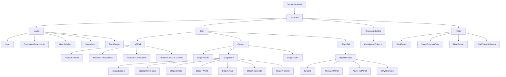

# Guided Flow v2 — Frontend Implementation Spec

> **Companion to:** `02-guided-flow-v2.md` (visual spec) and `02-guided-flow.svg` (v1 visual artifact, superseded).
> **Audience:** the frontend implementation task running in parallel.
> **Scope of THIS doc:** component tree, state shape, file layout, wiring map. No backend changes.
> **Status:** spec · ready to build against · 2026-07-29

---

## 0. Scope & Boundaries

### What this task touches
- `web/src/views/GuidedFlow/` (new directory)
- `web/src/store/productionStore.ts` (extend, do not break existing API)
- `web/src/components/` (new shared components — Crew, ConfirmGate, WhyThis)

### What this task must NOT touch (to avoid collisions with parallel tasks)
- `src/agents/`, `src/validation/`, `src/audit/`, `src/service/`, `src/schema/` — backend
- `src/public_demo/` — server (unless wiring the new store to it; see §6)
- `docs/wireframes/02-guided-flow-v2.md` — design spec (read-only)
- `docs/wireframes/README.md` — index (read-only)
- `web/src/views/AgentConsole/`, `web/src/views/ProductionFlow/` — existing views
  - **Strategy:** the old `ProductionFlow/index.tsx` is **replaced** in-place (option A in the design discussion). The old files `StepIndicator.tsx`, `IntentForm.tsx`, `AngleCards.tsx`, `PipelineWizard.tsx`, `ResultPanel.tsx` are **deleted** at the end of the migration; until then, leave them in place but stop importing them.

### Dependencies this task can rely on (already built)
- `useProductionStore` (Zustand) — extends cleanly
- `ProductionService.save()` — thread-safe persistence
- `audit_trail` array on `Production` — read for crew-status derivation
- `PipelineWizard` 26-stage grid — **reused** in the right-rail pass log on Stage 6
- Existing CSS variables (`--accent`, `--purple`, `--surface-1`, `--border`, `--text`, etc.) — **reuse**, do not introduce a new token system

---

## 1. Component Tree



### Per-component role

| Component | Role |
|---|---|
| `GuidedFlowView` | Route component, mounts `AppShell`. Reads `currentStage` from store and renders the right `StageN` inside `Canvas`. |
| `AppShell` | Persistent chrome — Header + Body + CrewActivityStrip + Footer. Single layout grid. |
| `Header` | Production context + view-switch + draft-state badge. |
| `Body` | Horizontal flex: LeftRail \| Canvas \| RightRail. |
| `LeftRail` | 60 px collapsed icons. Expand on hover to 200 px. |
| `Canvas` | Stage-specific content. Always renders StageHeader + StageBody + StageFooter. |
| `RightRail` | 300 px collapsible. Hosts `RightRailTabs`. |
| `CrewActivityStrip` | 40 px persistent strip showing every active agent. **The single most important new component.** |
| `Footer` | Back / ProgressDots / Next + autosave indicator. |
| `Stage1Vision .. Stage7Publish` | One component per stage. Each owns its own layout, components, and CTA. |
| `RightRailTabs` | Tab strip: Tip (default), Glossary, Audit, Why. |
| `CrewAgentChip` | One agent in the strip. Status dot + name + current task. Click opens detail in right-rail Why tab. |

---

## 2. File Layout

### New files (create)

```
web/src/views/GuidedFlow/
  index.tsx                        # mounts AppShell
  AppShell.tsx                     # the persistent chrome grid
  Header.tsx
  LeftRail.tsx
  RightRail.tsx
  Footer.tsx
  StageProgressDots.tsx            # replaces StepIndicator
  DraftBadge.tsx
  DraftSavedIndicator.tsx
  WhatHappensNext.tsx              # the in-canvas preview footer
  ConfirmGateModal.tsx             # hard-gate modal
  WhyThisPopover.tsx               # inline popover (also opens WhyThisPanel)
  SkipAheadModal.tsx               # soft-gate skip modal
  stages/
    Stage1Vision.tsx
    Stage2References.tsx
    Stage3Angle.tsx
    Stage4World.tsx
    Stage5Plan.tsx
    Stage6Generate.tsx
    Stage7Publish.tsx
  rightRail/
    TipCard.tsx
    GlossaryPanel.tsx
    AuditTrailPanel.tsx
    WhyThisPanel.tsx
  crew/
    CrewActivityStrip.tsx
    CrewAgentChip.tsx
    useCrewStatus.ts               # hook: derive crew from stage + audit_trail
    stages.ts                      # CREW_BY_STAGE table

web/src/components/
  ConfirmGateModal.tsx             # exported (used by stages too)
  SkipAheadModal.tsx

web/src/lib/
  stages.ts                        # frozen STAGES meta array (Stage 1..7)
  confirmGate.ts                   # prompt + decision logic
```

### Modified files (extend, do not break)

- `web/src/store/productionStore.ts` — add v2 fields + actions (see §3)
- `web/src/types/production.ts` — add new types (see §4)
- `web/src/App.tsx` — route `/guided` continues to work; mount `GuidedFlowView` instead of `ProductionFlow`

### Files to delete at the end of the migration

- `web/src/views/ProductionFlow/StepIndicator.tsx`
- `web/src/views/ProductionFlow/IntentForm.tsx`
- `web/src/views/ProductionFlow/AngleCards.tsx`
- `web/src/views/ProductionFlow/ResultPanel.tsx`
- `web/src/views/ProductionFlow/index.tsx`
- `web/src/views/ProductionFlow/PipelineWizard.tsx` — **save** it; re-export from `web/src/views/GuidedFlow/rightRail/PassLogPanel.tsx` for Stage 6

**Migration rule:** keep the old files compiling until the new route is wired up. Then delete in one commit.

---

## 3. State Shape (Zustand store extensions)

Extend `useProductionStore`. Add the following. Do not remove any existing fields.

```ts
// New slice — add to productionStore.ts
interface GuidedFlowSlice {
  // ── Local UI state ──
  currentStage: 1 | 2 | 3 | 4 | 5 | 6 | 7
  isLoading: boolean
  loadingMessage: string
  rightRailTab: 'tip' | 'glossary' | 'audit' | 'why'
  crewStripCollapsed: boolean
  activeGenerationPass: number          // Stage 6 only; null elsewhere
  selectedCrewAgent: string | null      // opens detail in right-rail Why tab

  // ── Gate / modal state ──
  confirmGatePending: ConfirmGateRequest | null
  skipAheadModal: { targetStage: 1|2|3|4|5|6|7; skippedStages: number[] } | null

  // ── Persistence indicators ──
  draftSavedAt: number | null           // epoch ms
  isSaving: boolean

  // ── Navigation actions ──
  setCurrentStage: (stage: 1|2|3|4|5|6|7) => Promise<void>
  goBack: () => void
  goNext: () => Promise<void>           // async because server commit
  requestSkipAhead: (target: 1|2|3|4|5|6|7) => void
  resolveSkipAhead: (confirmed: boolean) => void

  // ── Right rail ──
  setRightRailTab: (tab: 'tip'|'glossary'|'audit'|'why') => void
  selectCrewAgent: (agentId: string | null) => void
  toggleCrewStrip: () => void

  // ── Stage actions (call server, update store, write audit entry) ──
  submitIntent: (intent: IntentDocument) => Promise<void>
  addReference: (ref: Reference) => Promise<void>
  removeReference: (refId: string) => Promise<void>
  pickAngle: (angleId: 'skeptic'|'advocate'|'contrarian'|string) => Promise<void>
  remixAngle: (blend: { from: string[]; weights: number[] }) => Promise<void>
  commitCharacter: (char: Character) => Promise<void>
  commitEnvironment: (env: Environment) => Promise<void>
  lockPalette: (palette: MoodSpec) => Promise<void>
  commitShotPlan: (plan: ShotPlan) => Promise<void>
  regenerateShotPlan: () => Promise<void>
  approveGenerationPass: (passId: string) => Promise<void>
  overrideGeneration: (shotId: string, prompt: string) => Promise<void>
  pickManifest: (manifestId: string) => Promise<void>
  confirmPublish: () => Promise<void>

  // ── Confirm gate ──
  requestConfirmGate: (req: ConfirmGateRequest) => void
  resolveConfirmGate: (approved: boolean) => Promise<void>
}
```

### Server-backed fields (already in `Production`)

These are NOT in the local slice — they're part of the loaded `Production` document and persisted via `ProductionService`. The store caches the latest snapshot but the source of truth is `production.json`.

- `production.state` (DRAFT → BRIEFED → IN_PRODUCTION → IN_REVIEW → APPROVED → PUBLISHED)
- `production.intent`, `production.references`, `production.characters`, `production.environments`
- `production.scenes[].shots[]`, `production.scenes[].mood`
- `production.timeline`
- `production.audit_trail`
- `production.branches`, `production.snapshots`
- `production.metadata.publish_manifest`, `production.metadata.asset_index`

### Component-local state (NOT in store)

- Form drafts (textarea values mid-keystroke) — debounced 500ms then committed via store actions
- Modal open/closed (ConfirmGateModal, SkipAheadModal manage their own)
- Hover/focus states
- Right-rail tab transitions (instant local; tab state still in store for deep-linking)

### State transitions (cross-stage)

| Stage transition | ProductionState change | Audit action |
|---|---|---|
| 1 → 2 | DRAFT (no change) | `stage_advance` |
| 2 → 3 | DRAFT → BRIEFED | `stage_advance` + `state_transition` |
| 3 → 4 | BRIEFED → IN_PRODUCTION | `gate_decision` (ConfirmGate HARD) + `state_transition` |
| 4 → 5 | IN_PRODUCTION | `stage_advance` |
| 5 → 6 | IN_PRODUCTION | `stage_advance` |
| 6 → 7 | IN_PRODUCTION → IN_REVIEW | `stage_advance` + `state_transition` |
| 7 (publish) | IN_REVIEW → APPROVED → PUBLISHED | `gate_decision` (PublicationGate HARD) |

---

## 4. TypeScript Types (additions to `web/src/types/production.ts`)

```ts
// ── Stage meta ──
export type StageNumber = 1 | 2 | 3 | 4 | 5 | 6 | 7

export interface StageMeta {
  number: StageNumber
  shortName: string                                // "Vision"
  fullName: string                                 // "State Your Vision"
  subtitle: string                                 // one-line user description
  isHardGate: boolean
  primaryAgent: AgentId | 'user'
  supportingAgents: AgentId[]
  expects: string[]                                // ProductionState values required to enter
  produces: string[]                               // state changes that happen on exit
}

export const STAGES: readonly StageMeta[] = [
  { number: 1, shortName: 'Vision',    fullName: 'State Your Vision',
    subtitle: 'What story, for whom, on what platform, in what tone.',
    isHardGate: false, primaryAgent: 'user',
    supportingAgents: ['ResearchAgent'],
    expects: ['DRAFT'], produces: [] },

  { number: 2, shortName: 'References', fullName: 'Pin Your References',
    subtitle: 'Ground the story in references with full provenance.',
    isHardGate: false, primaryAgent: 'ReferenceClusteringAgent',
    supportingAgents: ['ResearchAgent', 'MoodboardAgent'],
    expects: ['DRAFT'], produces: ['BRIEFED'] },

  { number: 3, shortName: 'Angle',     fullName: 'Find Your Angle',
    subtitle: 'Pick the creative angle that frames the story.',
    isHardGate: true, primaryAgent: 'CreativeReframing',
    supportingAgents: ['ConfirmGate'],
    expects: ['BRIEFED'], produces: ['IN_PRODUCTION'] },

  { number: 4, shortName: 'World',     fullName: 'Build Your World',
    subtitle: 'Define characters, locations, and the consistency contract.',
    isHardGate: false, primaryAgent: 'CharacterDirectorAgent',
    supportingAgents: ['EnvironmentArtistAgent', 'MoodboardAgent', 'AssetLibraryAgent'],
    expects: ['IN_PRODUCTION'], produces: [] },

  { number: 5, shortName: 'Plan',      fullName: 'Plan the Production',
    subtitle: 'Scenes, shots, camera, lighting, storyboard.',
    isHardGate: false, primaryAgent: 'ShotPlanningAgent',
    supportingAgents: ['StoryAgent', 'ScriptAgent', 'ShotDesignerAgent', 'StoryboardArtistAgent'],
    expects: ['IN_PRODUCTION'], produces: [] },

  { number: 6, shortName: 'Generate',  fullName: 'Generate & Polish',
    subtitle: 'Run the crew, review each pass, iterate.',
    isHardGate: true, primaryAgent: 'GenerationAgent',
    supportingAgents: ['AnimationDirectorAgent', 'VoiceDirectorAgent', 'MusicComposerAgent',
                       'SoundDesignerAgent', 'ColoristAgent', 'EditorAgent'],
    expects: ['IN_PRODUCTION'], produces: ['IN_REVIEW'] },

  { number: 7, shortName: 'Publish',   fullName: 'Publish with Evidence',
    subtitle: 'Lock the cut, pass the final gate, archive.',
    isHardGate: true, primaryAgent: 'PublisherAgent',
    supportingAgents: ['ReviewerAgent'],
    expects: ['IN_REVIEW'], produces: ['APPROVED', 'PUBLISHED'] },
] as const

// ── Crew strip ──
export type CrewStatus = 'idle' | 'ready' | 'thinking' | 'proposing' | 'flagged'

export interface CrewAgentChip {
  agentId: AgentId
  displayName: string                            // "ResearchAgent"
  avatarColor: string                            // CSS var, e.g. 'var(--accent)'
  status: CrewStatus
  currentTask?: string                           // "scanning 4 sources"
  href?: string                                  // deep-link to Agent Console
}

export type AgentId =
  | 'CreativeReframing' | 'ResearchAgent' | 'ReferenceClusteringAgent'
  | 'MoodboardAgent' | 'StoryAgent' | 'ScriptAgent'
  | 'CharacterDirectorAgent' | 'EnvironmentArtistAgent' | 'ShotPlanningAgent'
  | 'ShotDesignerAgent' | 'StoryboardArtistAgent' | 'AssetLibraryAgent'
  | 'GenerationAgent' | 'AnimationDirectorAgent' | 'VoiceDirectorAgent'
  | 'MusicComposerAgent' | 'SoundDesignerAgent' | 'ColoristAgent'
  | 'EditorAgent' | 'ReviewerAgent' | 'PublisherAgent' | 'ConfirmGate'

// ── Confirm gate ──
export interface ConfirmGateRequest {
  stage: StageNumber
  reason: string                                 // "Hard gate: must pick an angle."
  options: ('approve' | 'skip')[]                 // hard = ['approve'] only; soft = ['approve', 'skip']
  blocker?: string                               // for the footer disable message
}

// ── Right rail ──
export type RightRailTab = 'tip' | 'glossary' | 'audit' | 'why'

// ── Generation pass (Stage 6) ──
export interface GenerationPass {
  id: string                                     // "frames" | "voice_music" | "sound" | ...
  label: string                                  // "Frames", "Voice + Music"
  status: 'queued' | 'running' | 'approved' | 'flagged' | 'rejected'
  progressPct?: number
  artifacts?: Array<{ shotId: string; status: 'pending'|'approved'|'rejected'; thumbUri?: string }>
  reviewerVerdict?: { score: number; verdict: 'pass'|'warn'|'fail'; checks: unknown[] }
}
```

---

## 5. Crew Activity Strip — Strategy

### Why a pure-function derivation (not a WebSocket)

The kernel is single-process and uses `audit_trail` as the source of truth. There is no agent-state stream exposed today. The Crew Strip should:

1. **Static by stage** — each stage has a known crew (defined in `crew/stages.ts`).
2. **Live overlay from audit_trail** — derive the current task + status from the most recent N audit entries for each agent.

This is enough for the v2 frontend. It's deterministic, testable, and survives a refresh. A real-time stream is a v3 concern.

### `web/src/views/GuidedFlow/crew/stages.ts`

```ts
import type { AgentId, StageNumber } from '../../types/production'

interface StageCrew {
  agentId: AgentId
  defaultStatus: 'ready' | 'idle'
  defaultTask?: string
  scopeOneLiner: string                         // shown in the right-rail Why tab
}

export const CREW_BY_STAGE: Record<StageNumber, StageCrew[]> = {
  1: [
    { agentId: 'ResearchAgent',         defaultStatus: 'thinking', defaultTask: 'scanning prior work', scopeOneLiner: 'Scans for prior projects + papers on the topic.' },
    { agentId: 'ReferenceClusteringAgent', defaultStatus: 'idle',  scopeOneLiner: 'Groups references into clusters (idle until Stage 2).' },
    { agentId: 'ReviewerAgent',         defaultStatus: 'ready',   scopeOneLiner: 'Validates every artifact against the brief.' },
  ],
  2: [
    { agentId: 'ResearchAgent',         defaultStatus: 'thinking', defaultTask: 'compiling 4 sources', scopeOneLiner: 'Validates the >=3-sources gate.' },
    { agentId: 'ReferenceClusteringAgent', defaultStatus: 'thinking', defaultTask: 'extracting style tokens', scopeOneLiner: 'Clusters references; assigns SHA-256.' },
    { agentId: 'MoodboardAgent',        defaultStatus: 'idle',     scopeOneLiner: 'Builds the mood palette (queued for Stage 4).' },
    { agentId: 'ReviewerAgent',         defaultStatus: 'ready',    scopeOneLiner: 'Checks provenance.' },
  ],
  3: [
    { agentId: 'CreativeReframing',     defaultStatus: 'thinking', defaultTask: 'sampling 3 angles', scopeOneLiner: 'Produces skeptic / advocate / contrarian.' },
    { agentId: 'ConfirmGate',           defaultStatus: 'idle',     scopeOneLiner: 'Hard gate: requires explicit user approval.' },
    { agentId: 'ReviewerAgent',         defaultStatus: 'ready',    scopeOneLiner: 'Scores each angle for fit with the brief.' },
  ],
  4: [
    { agentId: 'CharacterDirectorAgent', defaultStatus: 'thinking', defaultTask: 'drafting 3 characters', scopeOneLiner: 'Proposes character profiles + consistency contracts.' },
    { agentId: 'EnvironmentArtistAgent', defaultStatus: 'thinking', defaultTask: 'drafting 2 locations', scopeOneLiner: 'Proposes environment specs.' },
    { agentId: 'MoodboardAgent',         defaultStatus: 'thinking', defaultTask: 'sealing palette', scopeOneLiner: 'Locks the visual palette.' },
    { agentId: 'AssetLibraryAgent',      defaultStatus: 'idle',     scopeOneLiner: 'Indexes all generated assets (Stage 15).' },
    { agentId: 'ReviewerAgent',          defaultStatus: 'ready',    scopeOneLiner: 'Checks consistency contracts.' },
  ],
  5: [
    { agentId: 'StoryAgent',             defaultStatus: 'ready',   scopeOneLiner: 'Story arc.' },
    { agentId: 'ScriptAgent',            defaultStatus: 'ready',   scopeOneLiner: 'Script lines.' },
    { agentId: 'ShotPlanningAgent',      defaultStatus: 'thinking', defaultTask: 'drafting 12 shots', scopeOneLiner: 'Scenes + shots + timing.' },
    { agentId: 'ShotDesignerAgent',      defaultStatus: 'idle',    scopeOneLiner: 'Camera + lighting specs per shot.' },
    { agentId: 'StoryboardArtistAgent',  defaultStatus: 'idle',    scopeOneLiner: 'ASCII blocking frames.' },
    { agentId: 'ReviewerAgent',          defaultStatus: 'ready',   scopeOneLiner: 'Checks plan feasibility.' },
  ],
  6: [
    { agentId: 'GenerationAgent',        defaultStatus: 'thinking', defaultTask: 'frames pass', scopeOneLiner: 'Runs the multi-backend generation pass.' },
    { agentId: 'AnimationDirectorAgent', defaultStatus: 'idle',    scopeOneLiner: 'Animation pass.' },
    { agentId: 'VoiceDirectorAgent',     defaultStatus: 'idle',    scopeOneLiner: 'Voice synthesis + direction.' },
    { agentId: 'MusicComposerAgent',     defaultStatus: 'idle',    scopeOneLiner: 'Music cues.' },
    { agentId: 'SoundDesignerAgent',     defaultStatus: 'idle',    scopeOneLiner: 'SFX + ambient.' },
    { agentId: 'ColoristAgent',          defaultStatus: 'idle',    scopeOneLiner: 'Color grade.' },
    { agentId: 'EditorAgent',            defaultStatus: 'idle',    scopeOneLiner: 'Timeline assembly.' },
    { agentId: 'ReviewerAgent',          defaultStatus: 'ready',   scopeOneLiner: 'Validates every artifact.' },
  ],
  7: [
    { agentId: 'PublisherAgent',         defaultStatus: 'thinking', defaultTask: 'drafting 3 manifests', scopeOneLiner: 'Proposes publish manifests.' },
    { agentId: 'ReviewerAgent',          defaultStatus: 'ready',   scopeOneLiner: 'Final QA.' },
  ],
}
```

### `useCrewStatus` hook

```ts
// web/src/views/GuidedFlow/crew/useCrewStatus.ts
export function useCrewStatus(stage: StageNumber): CrewAgentChip[] {
  const auditEntries = useProductionStore(s => s.production?.audit_trail ?? [])
  return useMemo(() => {
    const crew = CREW_BY_STAGE[stage] ?? []
    return crew.map(c => {
      const recent = auditEntries
        .filter(e => e.actor === c.agentId)
        .slice(-3)
      const status = deriveStatus(recent, c.defaultStatus)
      const currentTask = recent[recent.length - 1]?.reason ?? c.defaultTask
      return { agentId: c.agentId, displayName: c.agentId, avatarColor: pickColor(c.agentId),
               status, currentTask, scopeOneLiner: c.scopeOneLiner }
    })
  }, [stage, auditEntries])
}
```

**`deriveStatus` rule of thumb:**
- Recent entry within last 5s with `action_type` `decision` → `'thinking'`
- Recent entry with `action_type` `gate_decision` + `verdict` `'fail'` → `'flagged'`
- Recent entry with `action_type` `gate_decision` + `verdict` `'pass'` → `'ready'`
- No recent entry → `defaultStatus`

---

## 6. Wiring Map

### Component → store reads

| Component | Reads from store |
|---|---|
| `Header` | `production.title`, `production.state` (via `DraftBadge`) |
| `LeftRail` | (none — static icons) |
| `Canvas` | `currentStage` |
| `Stage1Vision` | `intent`, `isLoading` |
| `Stage2References` | `production.references`, `isLoading` |
| `Stage3Angle` | `production.intent.angles` (proposals), `production.intent.chosen_angle` |
| `Stage4World` | `production.characters`, `production.environments`, `production.scenes[].mood` |
| `Stage5Plan` | `production.scenes`, `production.timeline` |
| `Stage6Generate` | `production.scenes[].shots[]`, `activeGenerationPass` |
| `Stage7Publish` | `production.metadata.publish_manifest`, `production.audit_trail` |
| `RightRail` | `rightRailTab`, `selectedCrewAgent` |
| `TipCard` | `currentStage` (to pick the right tip) |
| `GlossaryPanel` | `currentStage` (stage-scoped glossary) |
| `AuditTrailPanel` | `production.audit_trail` (last 50, paginated) |
| `WhyThisPanel` | `selectedCrewAgent` (renders `scopeOneLiner` + recent decisions) |
| `CrewActivityStrip` | `crewStripCollapsed`, then calls `useCrewStatus(currentStage)` |
| `CrewAgentChip` | (props only — `CrewAgentChip` object) |
| `StageProgressDots` | `currentStage` |
| `NextButton` | `currentStage`, `confirmGatePending`, `STAGES[currentStage].isHardGate` |
| `BackButton` | `currentStage` |
| `DraftSavedIndicator` | `draftSavedAt`, `isSaving` |
| `ConfirmGateModal` | `confirmGatePending` |
| `SkipAheadModal` | `skipAheadModal` |

### Component → store actions

| Component | Calls |
|---|---|
| `Stage1Vision` | `submitIntent(intent)` |
| `Stage2References` | `addReference(ref)`, `removeReference(refId)` |
| `Stage3Angle` | `pickAngle(id)` or `remixAngle(blend)` — both gated by `requestConfirmGate` |
| `Stage4World` | `commitCharacter`, `commitEnvironment`, `lockPalette` |
| `Stage5Plan` | `commitShotPlan`, `regenerateShotPlan` |
| `Stage6Generate` | `approveGenerationPass`, `overrideGeneration`; advances `activeGenerationPass` |
| `Stage7Publish` | `pickManifest`, `confirmPublish` |
| `NextButton` | `goNext` (which internally calls `requestConfirmGate` for hard stages) |
| `BackButton` | `goBack` |
| `StageProgressDots` | `setCurrentStage(stage)` (which opens `skipAheadModal` if target > current) |
| `RightRailTabs` | `setRightRailTab(tab)` |
| `CrewActivityStrip` | `toggleCrewStrip` (on hover-expand only — not user toggle in v1) |
| `CrewAgentChip` | `selectCrewAgent(agentId)` (opens WhyThisPanel) |
| `ConfirmGateModal` | `resolveConfirmGate(approved)` |
| `SkipAheadModal` | `resolveSkipAhead(confirmed)` |

### Server commit pattern (every store action)

```
async function someAction(input) {
  setLoading(true)
  try {
    const event = buildEvent(input)              // pure: input -> AuditEntry
    await ProductionService.applyEvent(event)    // thread-safe write to production.json
    const updated = await ProductionService.load()
    setProduction(updated)                       // store reflects new state
    setDraftSavedAt(Date.now())
  } finally {
    setLoading(false)
  }
}
```

This pattern is what every stage action should follow. It's the same shape as the existing `loadAngles()` / `setIntent()` calls — extending not replacing.

### ConfirmGate wiring

```ts
// Inside goNext() — for hard-gate stages
async function goNext() {
  const meta = STAGES[currentStage - 1]
  if (meta.isHardGate) {
    requestConfirmGate({
      stage: currentStage,
      reason: `Hard gate: you must complete ${meta.fullName} before continuing.`,
      options: ['approve'],
    })
    return  // resolution happens via ConfirmGateModal
  }
  // soft-gate: just advance
  await setCurrentStage(currentStage + 1)
}

// Inside resolveConfirmGate(true)
async function resolveConfirmGate(approved: boolean) {
  if (!confirmGatePending) return
  if (!approved) return                                    // user backed out
  const next = confirmGatePending.stage + 1
  await setCurrentStage(next)                             // commits audit + state_transition
  setConfirmGatePending(null)
}
```

---

## 7. Open Questions for the Frontend Task

These are decisions to surface to the design author (Boris) or the user (Kartikey) before locking the build.

| # | Question | Suggested decision | Why it matters |
|---|----------|--------------------|----------------|
| 1 | Form drafts: debounce 500ms then commit, or commit on blur? | Debounce 500ms | Autosave indicator needs consistent cadence. |
| 2 | Mobile breakpoint — skip entirely, or read-only progress view? | Skip for v1 | Sam is desktop-first; v1 ships desktop only. |
| 3 | Theme tokens — extend existing CSS vars, or new tokens? | Extend existing | Keep visual identity consistent with v1. |
| 4 | Keyboard nav: arrow keys for back/next, ⌘K palette, Esc for modals? | Yes to all three | Standard power-user affordance. |
| 5 | "Why this?" affordance: inline ⓘ popover only, or inline + right-rail tab? | Both | Inline for context; tab for full audit. |
| 6 | Crew Strip collapse: hover-expand (no toggle) or persistent toggle? | Hover-expand only | Less chrome; power users can navigate to Agent Console. |
| 7 | `useCrewStatus` polling: derive from `audit_trail` snapshot, or subscribe to mutations? | Snapshot + memo | Sufficient for v1; avoids polling cost. |
| 8 | Stage transition animation: slide-up (existing `anim-slide-up`) or fade? | Keep existing | Avoid re-skinning animations. |
| 9 | `PipelineWizard` (26-stage grid): delete or re-export as right-rail pass log? | Re-export on Stage 6 | Preserves the 26-stage overview value. |
| 10 | Old `ProductionFlow/*` files: delete in same commit, or feature-flagged migration? | Same commit once route is wired | Avoids stale imports. |

---

## 8. Build Order (suggested)

A working slice every 2-3 hours, smallest-first:

1. **Slice 1 — Shell only.** `AppShell` + `Header` + `LeftRail` + `Footer` + `CrewActivityStrip` (empty) + `RightRail` (empty tabs). One route `/guided` mounts it. Existing views still work at other routes.
2. **Slice 2 — Stage 1.** `Stage1Vision` mounted in the canvas; right-rail `TipCard` with stage-1 tip. Verifies store actions + autosave.
3. **Slice 3 — StageProgressDots.** Replace `StepIndicator`. Click-to-jump wired. SkipAheadModal mounted.
4. **Slice 4 — Stages 2, 3, 4, 5.** One at a time, each on its own slice. Stages 2 and 3 verify the Crew Strip lighting up. Stage 3 verifies the ConfirmGate modal.
5. **Slice 5 — Stage 6 (the hard one).** Generation pass cards + per-pass action palette + re-exported `PipelineWizard` as pass log in right-rail.
6. **Slice 6 — Stage 7 + cleanup.** Three manifests, audit summary panel, final publish CTA. Then delete the old `ProductionFlow/*` files and switch the route mount.

---

## 9. Acceptance Checklist

Each slice passes when:

- [ ] Component renders with the existing dark theme (`#0f1117`, accent `#6b8eff`, purple `#a78bfa`)
- [ ] State changes flow through `useProductionStore`, not local component state (except form drafts mid-keystroke)
- [ ] Every server-mutating action writes an `AuditEntry` with the correct `actor` + `action_type`
- [ ] `ProductionService.save()` is the only place `production.json` is mutated
- [ ] `CrewActivityStrip` lights up correctly for the stage's crew (matches `CREW_BY_STAGE`)
- [ ] Hard-gate stages (3, 6, 7) cannot advance without `ConfirmGateModal` resolution
- [ ] Autosave indicator updates within 1s of any change
- [ ] Refresh restores the user's last stage + drafts (via `ProductionService.load`)
- [ ] `StageProgressDots` lets the user jump back without losing work
- [ ] No file outside the boundary in §0 is modified

---

*Spec version: 1.0 · 2026-07-29 · ready for parallel build · supersedes the v1 step-based `ProductionFlow/index.tsx` once route is switched*
